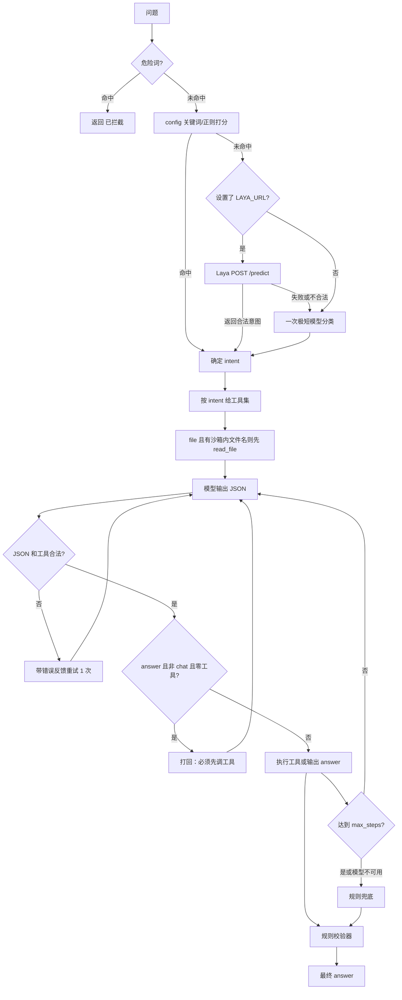

# mini-agent 小模型设计笔记（2026-10-12）

代码位置：`~/tools/mini-agent/`（示例）。本文件不含 API key。

## 1. 7B–14B Q4 当智能体为什么会失败

- 工具多了乱选：工具 schema 一多，小模型对工具名和参数的分辨能力下降，容易选错工具或填错参数。
- 长计划走偏：步骤一多，子目标会被模型丢开，出现重复调用、跳步、答非所问。
- JSON 格式不稳：Q4 小模型容易输出代码块、零宽字符、多余文字、尾逗号，解析直接失败。
- 没查到也编：模型偏向给一个看起来完整的答案，数字尤其容易凭空出现。
- 步骤一多上下文漂移：工具结果和中间消息堆起来后，前面的约束会被模型忽略。

处理思路是把模型限制在很小的决策面里：先路由，再给少量工具，每步只出小 JSON，循环和状态交给代码。

## 2. 每个机制怎么补

| 失败点 | 做法 | 代码位置 |
|---|---|---|
| 路由不确定 | 先拦危险词；再按 `config.json` 关键词 +1、正则 +2 打分；规则不命中时，可选 POST Laya `/predict`；还不命中才做一次极短模型分类（`max_tokens=16`，只输出类别名，不在白名单归 chat） | `match_danger`、`classify_rules`、`laya_predict`、`classify_model` |
| 工具选择乱 | 按 intent 给工具：file 给 `read_file`、`search_files`；shell 给 `run_shell`、`search_files`；web 给 `web_fetch`；note 给 `note_append`；chat 和 out_of_scope 不给工具。`valid_step` 检查工具名必须在当前 intent 的允许列表里 | `run_agent`、`valid_step`、`config.json` |
| JSON 不稳 | 请求带 `response_format: {"type":"json_object"}`，`temperature=0`；`extract_json` 去掉代码块和零宽字符，先整体解析，失败再抓首个 `{...}`；无效输出带错误反馈重试 1 次；服务器对 `response_format` 报 4xx 时去掉该字段重试一次 | `chat_completion`、`extract_json`、`ask_model`、`feedback_for` |
| 计划走偏 | `max_steps=4`，循环由代码控制。file intent 里若问题点名的文件在沙箱内存在，先调 `read_file`，把结果作为工具消息塞进上下文。非 chat intent 还没调工具就输出 answer，会被提示“打回”重试一次 | `run_agent` |
| 没查到也编 | system prompt 要求只依据工具结果；规则校验器检查答案里的每个数字必须出现在工具结果或问题里，否则改成「查不到可靠信息」；非 chat intent 没有任何工具结果且答案不含「不知道/查不到」，改成「查不到相关信息」 | `validate_answer` |
| 危险命令 | 危险词在进模型前拦截；工具参数也会再过一遍危险词；`run_shell` 只允许白名单命令，`shlex` 解析，禁管道、重定向、后台、命令替换，参数必须落在沙箱内 | `match_danger`、`t_run_shell`、`safe_resolve` |

模型接口不可用时按 intent 走规则兜底，保证基本可用；每一步写 stderr 和 `sandbox/trace.jsonl`。

## 3. 架构



## 4. config.json 示例

以下字段取自仓库里的 `config.json`：

```json
{
  "intents": {
    "chat": {
      "keywords": ["你好", "hi", "hello", "早", "晚安", "再见"],
      "regex": ["(?i)\\b(hello|hi|你好)\\b", "(?i)\\b(早安|晚安|再见)\\b"],
      "tools": [],
      "system": "你是友好的聊天助手，直接简洁回答，不使用工具。"
    },
    "file": {
      "keywords": ["文件", "内容", "上面", "写了", "项目", "预算", "代号"],
      "regex": ["(?i)\\b(文件|内容|信息)\\b", "(?i)\\b(项目|代号|预算|金额|元)\\b"],
      "tools": ["read_file", "search_files"],
      "system": "你只能根据工具返回的事实回答，查不到就答'不知道'或'查不到'。只用提供的工具。"
    },
    "shell": {
      "keywords": ["列出", "目录", "ls", "文件", "pwd", "echo"],
      "regex": ["(?i)\\b(列出|显示|查看|目录)\\b"],
      "tools": ["run_shell", "search_files"],
      "system": "执行只读命令，严格限制白名单。只根据返回事实回答。"
    },
    "web": {
      "keywords": ["网页", "网站", "搜索", "网页", "url"],
      "regex": ["(?i)\\b(网页|网站|网址|搜索|下载)\\b"],
      "tools": ["web_fetch"],
      "system": "根据网络获取结果回答，截断过长内容。"
    },
    "note": {
      "keywords": ["记一下", "笔记", "记录", "保存", "写入", "记"],
      "regex": ["(?i)\\b(记一下|笔记|记录|保存|写入)\\b"],
      "tools": ["note_append"],
      "system": "追加笔记到 notes.md。"
    },
    "out_of_scope": {
      "keywords": ["攻击", "黑客", "破解", "漏洞", "恶意"],
      "regex": ["(?i)\\b(攻击|黑客|破解|漏洞|恶意|入侵)\\b"],
      "tools": [],
      "system": "拒绝回答此类问题。"
    }
  },
  "danger_words": [
    "rm", "sudo", "mkfs", "dd", "shutdown", "poweroff", "reboot",
    "curl|sh", ">", "chmod", "chown", "passwd", "su -"
  ],
  "shell_whitelist": [
    "ls", "cat", "wc", "head", "date", "pwd", "echo", "grep"
  ],
  "max_steps": 4,
  "max_tokens": 256,
  "danger_response": "已拦截：不可逆操作"
}
```

## 5. 部署

模型服务器上用 llama-server，绑 `<model-host>:8080`，走 OpenAI 兼容的 `/v1` 路径。

客户端机器上设置：

```bash
export MINI_AGENT_BASE_URL=http://<model-host>:8080/v1
```

也可指向本机其他 OpenAI 兼容代理：

```bash
export MINI_AGENT_BASE_URL=http://127.0.0.1:3425/v1
```

`MINI_AGENT_MODEL` 可空，空则请求里不传 `model`；`MINI_AGENT_API_KEY` 可空，代码里不会打印。

## 6. 测试结果

`tests/run_tests.py` 建临时 sandbox，放入 `info.txt`（内容含「项目代号：青松，预算 37 万元」），跑 6 个用例：预算查询、未知事实拒答、危险命令拦截、闲聊零工具、列目录、记笔记。

| 模型 | 结果 |
|---|---|
| Ling-3.1-flash | 6/6 |
| OpenRouter nemotron-3-super-120b free | 6/6 |
| 本地 8B/14B Q4 | 尚未实测 |

## 7. 局限

- 只做单轮窄任务，不做多步规划；`max_steps` 是上限，不等于规划器。
- 关键词路由会误判，例如「文件」同时出现在 file 和 shell 的关键词里。
- 数字校验挡不住非数字的编造；只检查答案里的数字是否出现在工具结果或问题里。
- `web_fetch` 未实测。
- Laya 未实测。
